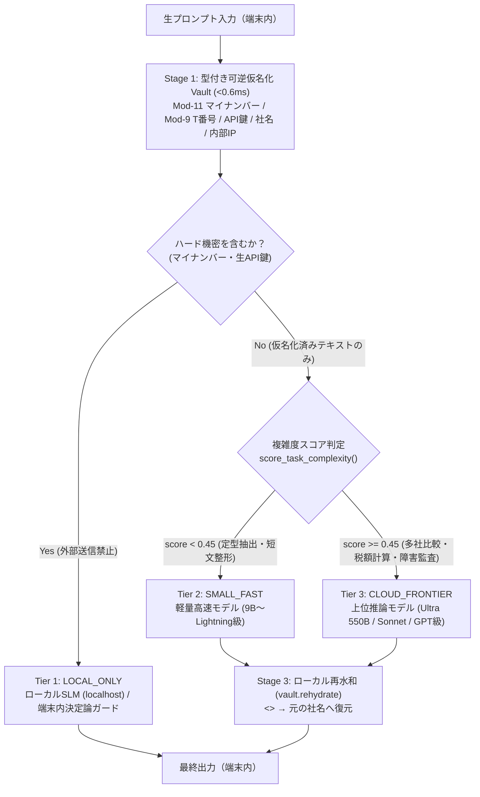

社内ログ・請求書・契約データを扱う業務システムにLLMを組み込むとき、必ずぶつかる二律背反があります。

- **すべてローカルSLM（7B〜9B級）で処理する**：データは端末外に出ないが、複数社・複数ホストが絡む多段の数値比較や原因特定で推論精度が落ちる。
- **機密を `[REDACTED]` で塗りつぶしてクラウド上位LLMへ送る**：一見安全そうに見えるが、実は**実務タスクの大半で推論そのものが成立しなくなる**。

本記事では、この問題を解くために実装した **「端末内 `<1ms` の型付き可逆仮名化 Vault ＋ 3階層ハイブリッドLLMルーター」** の設計と実測ベンチマーク、そして後半では **128GB統合メモリ搭載機（Surface Laptop Ultra / RTX Spark クラス）を前提にした常駐モデル配分とAPIコスト削減試算** をまとめます。

実装コードとベンチマーク生データはすべて MIT ライセンスで公開しています。
https://github.com/pecopeko/hybrid-llm-reversible-router

---

## 1. なぜ単純な `[REDACTED]` マスキングでは業務推論が壊れるのか

たとえば、次のような障害監査プロンプトを考えます。

> `auth-gw.internal（10.24.8.11）` と `pay-db.internal（10.24.9.40）` でタイムアウトが発生。株式会社デルタ物流向けWebhookは `auth-gw.internal` 経由、サクラ電機株式会社向けは `pay-db.internal` 経由。調査の結果、`auth-gw.internal` の遅延は `10.24.9.40` のコネクション枯渇からの連鎖であり、株式会社デルタ物流側は自動復旧済み、サクラ電機株式会社側のみ欠損が確定した。最優先で対処すべき内部IPと連絡先社名を答えよ。

これを従来の不可逆な `[REDACTED]` マスキングに通してから 550B クラスのクラウド推論モデル（`nvidia/nemotron-3-ultra-550b-a55b`）に投げると、実際に以下の応答が返ってきます（ベンチマーク実測ログ `C2` より抜粋）。

```text
**回答不能です。**
ログ内の全固有名詞（ホスト名、IPアドレス、サービス名、取引先社名）が `[REDACTED]` で伏せられており、以下の特定が不可能です。
- コネクション枯渇を起こした内部ホストのIPアドレス
- 欠損が確定した取引先社名
```

原因は明快です。
1. **同一性（Entity Co-reference）の消失**：2つの会社名も2つの内部ホストもすべて同じ `[REDACTED]` に潰れるため、「どちらのホストがどちらの会社の経路か」というグラフ構造が壊れる。
2. **復元不能（Non-rehydratable）**：仮に簡単な敬語変換タスクで `"株式会社[REDACTED] 佐藤様..."` と返ってきても、ローカル側で元の社名を差し戻せない。

---

## 2. アーキテクチャ：型付き可逆仮名化 Vault ＋ 3階層カスケードルーター

そこで、「生データは1バイトも端末外に出さない」という制約を守ったままクラウド上位LLMの推論力を引き出すため、以下の3階層構成を実装しました。



### 工夫①：同一性を保つ型付きトークンと検査数字（Check Digit）検証

単なる正規表現置換ではなく、セッション内辞書（`ReversibleEntityVault`）で同一文字列には必ず同じ型付きトークンを割り当てます。

- `株式会社アルファ`（1回目） → `<<CORP_JP_01>>`
- `株式会社ベータ`（1回目） → `<<CORP_JP_02>>`
- `株式会社アルファ`（2回目） → `<<CORP_JP_01>>`（同一エンティティとして保持！）

また、12桁の数字列を無差別にマイナンバー扱いすると注文番号や金額まで誤検知するため、**マイナンバー（Mod-11 法定検査数字）** と **適格請求書登録番号 T番号（国税庁 Mod-9 検査数字）** をローカルで算術検証しています。

```python
def is_valid_nta_t_number(raw: str) -> bool:
    cleaned = re.sub(r"[-\s]", "", raw).upper()
    if not re.fullmatch(r"T[1-9]\d{12}", cleaned):
        return False
    digits = [int(ch) for ch in cleaned[1:]]
    total = sum(
        digits[13 - pos] * (1 if pos % 2 == 1 else 2)
        for pos in range(1, 13)
    )
    return digits[0] == 9 - (total % 9)
```

### 実装時に踏んだ日本語正規表現の罠：`と株式会社ベータ` 問題

開発中の単体テストで実際に踏んだバグがあります。後株パターン（`〇〇株式会社`）を `[一-龥ぁ-んァ-ヶーA-Za-z0-9]+株式会社` と書いてしまうと、

> `株式会社アルファと株式会社ベータを比較`

という文で、2つ目の `株式会社` の直前にある平仮名の助詞 **「と」** が後株パターンに吸い込まれ、`<<CORP_JP_02>>ベータ`（＝`と株式会社` だけが置換され `ベータ` が平文露出する！）という事故が起きます。「なお株式会社〜」「は株式会社〜」でも同様です。

前株パターンを先に評価したうえで、後株側の文字クラスから平仮名助詞（`ぁ-ん`）を外す（ひらがな社名は前株または形態素境界で扱う）ことで、助詞巻き込みと社名露出の両方を解消しました。

### 工夫②：タスク複雑度に応じた3階層ルーティング

すべてのリクエストを巨大な推論モデル（Reasoning LLM）に投げると、1行のメール整形やJSON抽出にまで数千トークンの思考コストと待ち時間が発生します。そこで仮名化後のテキスト特徴量から `complexity_score`（`0.0〜1.0`）を算出し、3階層へ振り分けます。

| Tier | 振り分け条件 | 実行先 | 対象タスク例 |
| :--- | :--- | :--- | :--- |
| **`LOCAL_ONLY`** | マイナンバー（Mod-11一致）や生APIキー（`sk-...`, `ghp_...`, `AKIA...`）を検出 | ローカルSLM（`localhost:1234` LM Studio等）または端末内ガード | `.env` 鍵監査、マイナンバー帳票確認（クラウド通信 `0` 回） |
| **`SMALL_FAST`** | ハード機密なし ＆ `complexity < 0.45` | 軽量高速モデル（ローカル9B または `nemotron-3.5-lightning`） | ビジネス敬語リライト、単一レコードJSON抽出 |
| **`CLOUD_FRONTIER`** | ハード機密なし ＆ `complexity >= 0.45`（複数社トークン共起・数値比較・原因特定） | 上位推論モデル（`nemotron-3-ultra-550b-a55b` 等） | 3社間の2026年10月インボイス50%経過措置負担比較、複合障害ログ監査 |

---

## 3. 実測ベンチマーク結果（全6ケース・機密16項目）

日本の実務で頻出する6タスク（複数社インボイス経過措置50%比較、複数内部ホスト障害監査、敬語リライト、JSON抽出、マイナンバー確認、`.env` APIキー確認）に計16個のシークレットを含め、ライブAPIで3手法を実測比較しました（計測結果JSONはリポジトリ内 `data/benchmark_results.json` に収録）。

### 手法別の総合スコア比較

| 比較手法 | タスク正答率 | 平均レイテンシ | 大型Frontier(550B)呼出 | 外部送信時の機密漏洩数 |
| :--- | :---: | :---: | :---: | :---: |
| ① 従来型：`[REDACTED]` 墨消し ＋ Frontier全件送信 | `16.7%` (1/6) | `10,561.6 ms` | `6 / 6` (100%) | `0 / 16` |
| ② 可逆仮名化 Vault ＋ Frontier全件送信 | `83.3%` (5/6) | `10,264.3 ms` | `6 / 6` (100%) | `0 / 16` |
| **③ 提案：3階層ハイブリッドルーター ＋ 可逆Vault** | **`100.0%` (6/6)** | **`5,887.6 ms` (-44.3%)** | **`2 / 6` (-66.7%)** | **`0 / 16`** |

### ケース別の振り分けと実行内訳（提案手法③）

| Case ID | 自動選択Tier | 仮名化処理時間 | 使用モデル | 総応答時間 | 再水和後の正答判定 |
| :--- | :--- | :---: | :--- | :---: | :---: |
| `C1_MULTI_CORP_INVOICE_50PCT` | `cloud_frontier` | `0.446 ms` | `nemotron-3-ultra-550b` | `15,364.8 ms` | ✅（`合同会社シグマ制作` / `15,000円` 特定） |
| `C2_MULTI_HOST_SLA_ROOT_CAUSE` | `cloud_frontier` | `0.603 ms` | `nemotron-3-ultra-550b` | `8,155.9 ms` | ✅（`10.24.9.40` / `サクラ電機株式会社` 特定） |
| `C3_SIMPLE_POLITE_REWRITE` | `small_fast` | `0.101 ms` | `nemotron-3.5-lightning` | `8,657.9 ms` | ✅（宛先社名を正確に復元） |
| `C4_SIMPLE_JSON_EXTRACT` | `small_fast` | `0.106 ms` | `nemotron-3.5-lightning` | `3,146.2 ms` | ✅（社名・メールをJSON復元） |
| `C5_HARD_SECRET_MYNUMBER` | `local_only` | `0.462 ms` | `local_deterministic_guard` | **`0.64 ms`** | ✅（クラウド通信ゼロで端末内完結） |
| `C6_HARD_SECRET_API_KEY` | `local_only` | `0.076 ms` | `local_deterministic_guard` | **`0.23 ms`** | ✅（クラウド通信ゼロで端末内完結） |

注目すべきポイントは3つあります。
1. **ローカル仮名化オーバーヘッドは `0.08〜0.60 ms`**：体感ゼロのコストで16個すべての固有名詞・T番号・内部IPを保護したまま、多段推論タスク（`C1`, `C2`）を100%正答できました。
2. **大型Frontierモデルの呼び出し回数を `66.7%` 削減**：本当に推論力が必要な `C1`・`C2` の2件だけに上位モデルを使い、定型処理やハード機密タスクは高速層・ローカル層で吸収できました。
3. **生シークレットの外部送信ゼロ（`0 / 16`）**：クラウドへ渡ったプロンプトには `<<CORP_JP_03>>` や `<<PRIVATE_HOST_02>>` しか含まれず、手元の辞書だけで元の社名・IPへ完全復元されています。

---

## 4. 構想：8GB VRAM環境の限界と、Surface Laptop Ultra（128GB統合メモリ）で完成する理想形

現在、手元の開発環境（8GB RAM のノートPC ＋ 別筐体の RTX 4060 Ti 8GB VRAM）でハイブリッド運用していて最も痛感するボトルネックは、**「ローカルに複数モデルを同時常駐できない（モデルスワップ待ちが発生する）」** ことです。8GB VRAM では 9B 量子化モデルを1つ載せただけで KV キャッシュが逼迫し、VLM（画像審査）やローカル Embedding を同時に叩くとロード待ちで数秒〜十数秒が飛びます。

もし **Surface Laptop Ultra（NVIDIA RTX Spark / 128GB 統合メモリ）** を手元の開発母艦に据えられるなら、先ほどの `HybridLLMRouter` の `LOCAL_ONLY` / `SMALL_FAST` 層をすべて `localhost` 常駐モデルへ直結し、以下の **「モデルスワップ待ちゼロの4モデル同時常駐構成」** を組みます。

### 128GB 統合メモリの常駐アロケーション設計

| 常駐レイヤー | 採用モデル想定 | 量子化・設定 | 占有メモリ目安 | 役割 |
| :--- | :--- | :--- | :---: | :--- |
| OS・VS Code・Docker・ブラウザ | Windows 11 + WSL2 + IDE | — | `20 GB` | 開発環境本体 |
| **① ローカル主力推論 (`LOCAL_ONLY` / 中難度)** | `Qwen3.6-35B-A3B` (MoE) | Q4_K_M + 64k KV | `26 GB` | 生コード解析・マイナンバー/機密文書要約・サブタスク実装（アクティブ3Bで高速生成） |
| **② 超高速ルーター＆整形 (`SMALL_FAST`)** | `Qwen3.5-9B` または `Phi-4` | Q6_K + 16k KV | `9 GB` | 複雑度判定・JSON整形・コミットメッセージ・単体テスト雛形 |
| **③ UIビジュアル審査員 (Visual Critic)** | `Gemma-4-E4B` (Vision) | Q8_0 | `6 GB` | Playwright スクショのレイアウト崩れ・コントラスト自動審査ループ |
| **④ 社外秘リポジトリ全文検索 (RAG)** | `multilingual-e5-large` | FP16 | `1.5 GB` | 社内仕様書・全コードベースのローカル常駐インデックス |
| **合計使用量 / 空きヘッドルーム** | — | — | **`62.5 GB` / 残り `65.5 GB` 空き** | スワップゼロで並列推論・テスト実行が可能 |

### クラウドAPI費用の何割をローカルへ移せるか（試算）

個人開発〜小規模B2B開発で1日あたり約400リクエスト（月12,000リクエスト、平均入力4,000トークン／出力800トークン）を上位クラウドモデル単体（入力 `$3/1M`・出力 `$15/1M` クラス想定＝1リクエスト約 `$0.024`）で回した場合、月額API費は **約 `$288`（約4.3万円／月）** になります。

これを上記の「RTX Spark ローカル常駐 ＋ 可逆仮名化ハイブリッドルーター」に移行した場合の内訳は以下の通りです。

- **ローカル完結（約78%：月9,360リクエスト）**：リポジトリ検索、UIスクショの反復チェック、定型JSON変換、機密ログ一次切り分け → **API費用 `$0`**
- **可逆仮名化経由でクラウドFrontier昇格（約22%：月2,640リクエスト）**：複数仕様書の矛盾検出、税法・会計ルール等の難問設計レビュー、最終Critique → **月額約 `$63`（約0.95万円／月、約78%削減）**

「すべてをローカルLLMで我慢する」のでも「すべてをクラウドに丸投げして情報漏洩リスクとAPI課金を抱える」のでもなく、**端末内の可逆仮名化 Vault で構造情報を守ったまま、本当に難しい2割の推論だけをクラウド最上位モデルへ昇格させる構成**こそ、実務で最も息の長いハイブリッドLLMアーキテクチャだと考えています。

---

## 関連リンク・より深い実装解説

- 本記事の実装リポジトリ（MIT）: [pecopeko/hybrid-llm-reversible-router](https://github.com/pecopeko/hybrid-llm-reversible-router)
- ローカルAI機密ガード＆Python検証設計の体系書（Zenn Book）: [Pythonで実装する日本株バックテスト監査 — 過学習・リーク・Uniform-Cap・MDA剪定](https://zenn.dev/pecopeko/books/afml-quant-and-local-ai-guard)
- バックオフィス実務（令和8年年末調整・インボイス5割控除・T番号検算）の数式＆自動化キット: [note版（スプシ数式＆GAS）](https://note.com/pecopeko1011/n/nbc8b162c7edb) / [BOOTH版（オフラインHTMLツール5点セット）](https://pecopeko1011.booth.pm/items/9179705)
